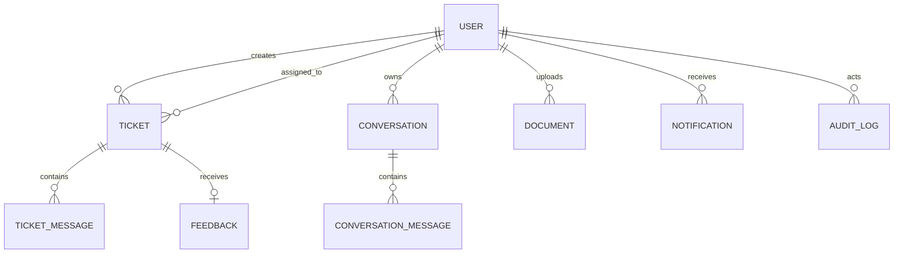

# Database schema design

## Conventions

All primary IDs are UUIDs. Timestamps are UTC `timestamptz`. Prisma creates database enums for roles and lifecycle states. Mutable records use `updatedAt`; status transitions that matter operationally also receive explicit timestamps and audit events. Qdrant, not PostgreSQL, stores embedding vectors.

## Core entities

| Model | Key fields | Relationships / constraints |
| --- | --- | --- |
| User | id, name, email, passwordHash, role, avatarUrl, isVerified | `email` unique; one customer-to-many tickets/conversations; optional assigned tickets for agents |
| RefreshToken | id, userId, tokenHash, expiresAt, revokedAt | Supports rotation and logout; hash only, never store raw token |
| Conversation | id, customerId, status, summary | Customer owns many conversation messages; soft/closed lifecycle |
| ConversationMessage | id, conversationId, senderId, senderType, content, sources, createdAt | Chronological index on `(conversationId, createdAt)`; sources are verified references JSON |
| Ticket | id, ticketNumber, customerId, assignedAgentId, subject, description, status, priority, category, sentiment, resolvedAt | Unique human-readable ticket number; indexes for customer/status, assignee/status, priority/status, creation time |
| TicketMessage | id, ticketId, senderId, senderType, body, kind, readAt | `kind` distinguishes customer, agent, internal note, system event; internal notes excluded from customer responses |
| Attachment | id, ticketMessageId?, documentId?, originalName, storedName, mimeType, sizeBytes, storagePath | One owner path enforced in application logic; opaque stored filename |
| Document | id, name, fileType, fileSize, storagePath, uploadedById, processingStatus, chunkCount, errorMessage | Admin-owned ingestion record; delete is coordinated with Qdrant point deletion |
| Feedback | id, ticketId, customerId, rating, comment | One feedback per customer/ticket; rating constrained 1–5 |
| Notification | id, userId, type, title, body, readAt | Durable in-app delivery; index on `(userId, readAt, createdAt)` |
| AuditLog | id, actorId?, action, resource, resourceId, metadata, createdAt | Append-only; metadata excludes secrets and unnecessary sensitive text |
| WorkflowDelivery | id, eventType, resourceId, status, attemptCount, responseCode | Tracks n8n attempts safely for retries/idempotency |

## Enumerations

- `Role`: `CUSTOMER`, `AGENT`, `ADMIN`
- `TicketStatus`: `OPEN`, `IN_PROGRESS`, `PENDING_CUSTOMER`, `RESOLVED`, `CLOSED`
- `TicketPriority`: `LOW`, `MEDIUM`, `HIGH`, `URGENT`
- `TicketCategory`: `BILLING`, `REFUND`, `DELIVERY`, `TECHNICAL_ISSUE`, `ACCOUNT`, `PRODUCT`, `SUBSCRIPTION`, `OTHER`
- `Sentiment`: `POSITIVE`, `NEUTRAL`, `NEGATIVE`, `FRUSTRATED`, `ANGRY`, `URGENT`
- `DocumentProcessingStatus`: `PENDING`, `PROCESSING`, `READY`, `FAILED`, `DELETED`

## Referential actions

Users are not hard-deleted while business records exist; deactivation/anonymization is preferred. Customer deletion requests require an explicit retention process. Deleting a document triggers a transactional status update followed by Qdrant cleanup, retaining an audit record. Ticket messages remain immutable after creation except narrowly scoped redaction; audit records are never cascaded away.

## Diagram

The Prisma schema will be introduced in Phase 1 alongside migrations and a realistic development seed.
